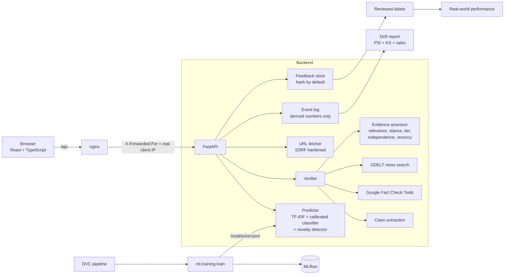
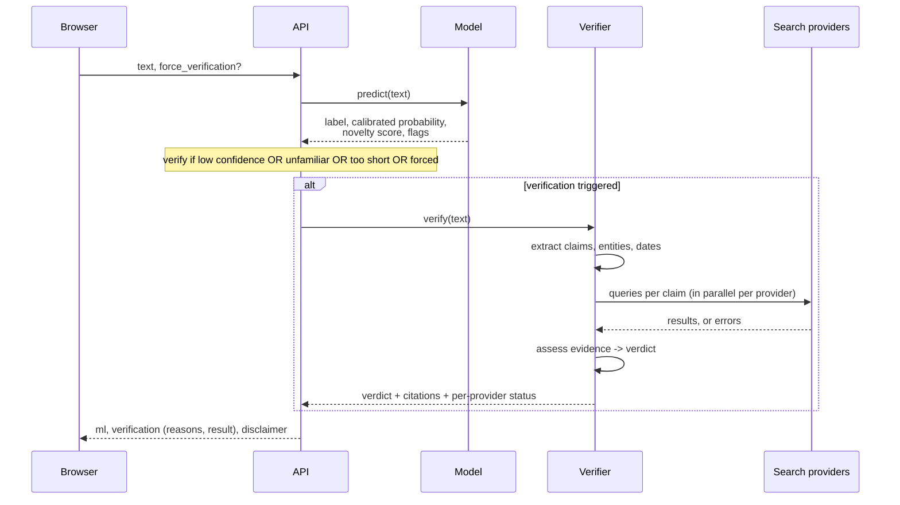

# Architecture

VeriNews keeps two questions apart on purpose:

1. **What does the writing look like?** A scikit-learn model scores style and vocabulary learned from
   one labelled dataset. This is *not* evidence about truth.
2. **What does the evidence say?** Fact-checks and news reports are retrieved online and assessed
   separately, with sources, dates and retrieval times.

## What happens on `POST /api/verify`

## Why verification is triggered
`needs_verification` is true when any of these holds, and the reasons are shown to the user:

| Trigger | Source of the threshold |
|---|---|
| Low confidence | Lowest confidence whose accepted predictions reach the target accuracy on half of the validation set |
| Unfamiliar text (out of distribution) | 95th percentile of validation novelty scores (mean cosine distance to nearest training documents in LSA space) |
| Fewer than 20 words | Fixed rule: the classifier is unreliable on very short text |
| User pressed *Verify online* | `force_verification` |

Probabilities are calibrated on the *other* half of the validation set, so thresholds are never chosen
on the data used for calibration. The test set is evaluated once.

## Verdict rules
| Evidence found | Verdict |
|---|---|
| Nothing relevant, or providers failed | **Inconclusive** (`completed: false` if no provider answered). Absence of results is never treated as "fake" |
| Fact-checkers rate it false | **Contradicted** |
| Fact-checkers rate it true | **Supported** |
| Fact-checkers disagree, or rate it half true / misleading | **Mixed Evidence** |
| News only | Needs several independent domains **and** one credible-tier source; headlines only give a weak signal and are labelled as such |

Fact-checks outweigh news. Overall verdict across claims is conservative: "Supported" needs every
checked claim supported.

## Trust boundaries
* **Article text** is untrusted input: validated, size-capped, never executed or logged.
* **Retrieved web content** is untrusted: stripped of markup/control characters, only `http(s)` links
  kept, and no LLM reads it (so there is no prompt-injection path today; if one is added later,
  retrieved text must stay in a data-only slot).
* **User-supplied URLs** go through the SSRF-hardened fetcher: public IPs only, every redirect
  re-validated, connection pinned to the validated IP, size/time/content-type limits.
* **API keys** live in environment variables and are never put in error messages or logs.

## Modules
| Path | Responsibility |
|---|---|
| `ml/preprocessing.py`, `ml/data.py` | Cleaning, de-leaking, de-duplication, leakage-safe splits |
| `ml/training/train.py` | Candidate comparison, calibration, thresholds, novelty detector, MLflow, artifacts |
| `ml/inference/` | `Predictor`, `NoveltyDetector` |
| `ml/monitoring/` | Event log, drift statistics, reviewed-label performance, review CLI |
| `ml/registry.py` | List / promote / roll back model versions |
| `backend/app/services/` | Claims, search providers, evidence assessment, verifier, feedback store |
| `backend/app/core/` | Settings, logging, metrics, rate limiter, SSRF-hardened fetch |
| `backend/app/api/routes.py` | HTTP endpoints |
| `frontend/` | Dashboard |
